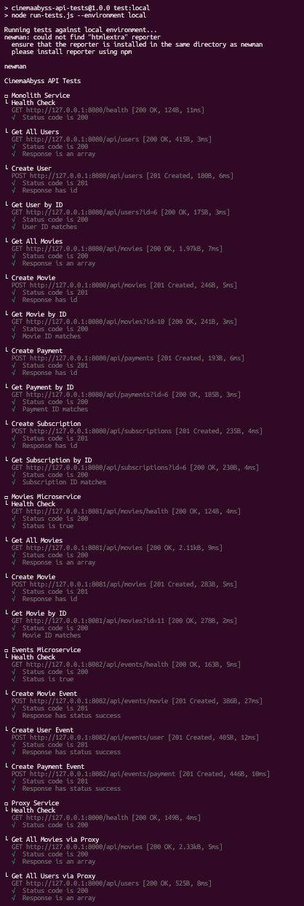
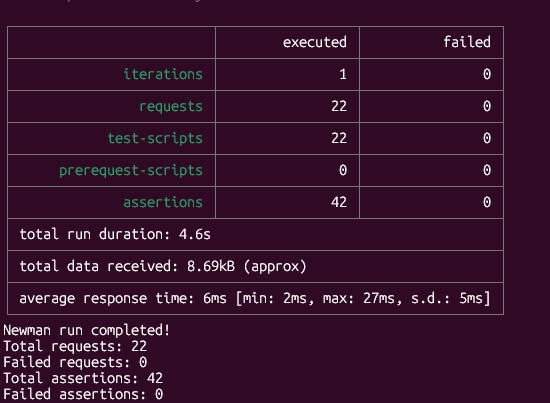
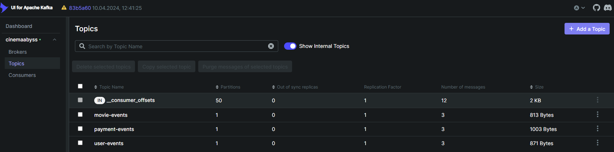
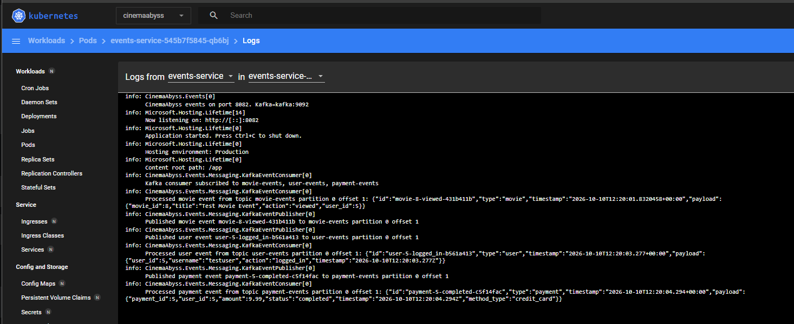
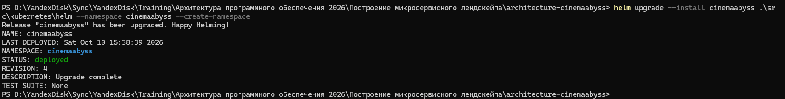
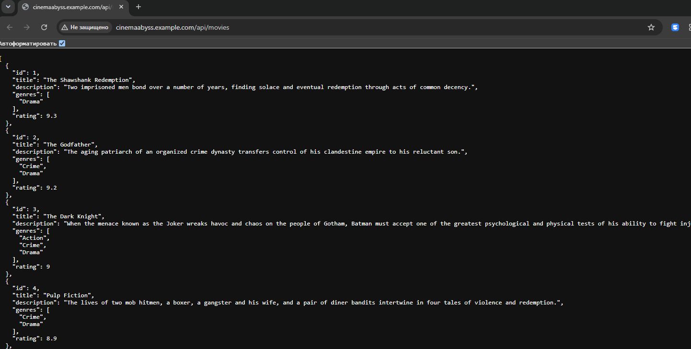

## Изучите [README.md](.\README.md) файл и структуру проекта.

# Задание 1

[Диаграмма контейнеров To-Be](https://www.plantuml.com/plantuml/png/bLPTRnj557tVNp54F2HIOp_04n9IqmJnqL2xjIk4X1IjxS4njNUjtLaY2o4bAUL3GIfK82I46l60U7KgXvWOEt_XxZ_Yd4pMcunJEtcmFJDxpxbtxhdtUk_6nezCqcchzLQWE_vQhHV7gXgktjDgFGoCZzCezjve1VLsqj1gsvXk_4wn6FaxXMRBR2Ur9DPH7POwC8Lws2bsstv0mjNODDgjMd7zxTKoZnv_l5di-B7H4Owsfjo5BcmzRtFjqzBZwbQrLDxQA7toO7d5yyfm70RBNxRqZexkg2NvBTsLORelnp9AVro2HQK7kixMlJ096dxKMuxFzpJzNOOobeaSmVX41bZtFmlaL4RIJ_T8aUwg-qbDHu4sEbvQKLzvIgdynijDt-WTlmUkjVA7wdsxMxBK4ncJGlu5BOXuAh_AW2v1_rpXuIJz3jxwIbwb1t82n2jiqZsQOpd42aS5tC5nosJ6vFipDrLo9XDUEIEoAM00hmbenM7jX4ZYBEr_sEnBNmRuZ45na3vJwJSof2yyXAyv5_x31Skn2tR3Y9DQN8zQNTCAW-ilES2tJSxf3Q_MzNiTLDvrTDIQq7zkdYaKMqE7BXT_P03KP4u-3c5ETR2tofzXqSS1bkDiFqdtc9jq7-KdGriTI22AXGPy00wWPmfZesPBOwD6Np_BBmkAeXp6fXdfoiDDK3bCjXnogciBOH79LJ5pBbV6XJoPW3c5AzqY2YjQnOIH9iLVpBkCMOa8uWSvTlGhrRxGTQDexpSrJ-H5zXm5t8Uge_HWHe67YKxqyXF_yoV-UQ3mGgauI7XJpXewesCRybhNhszhTPy8i7tjUOzqUphDilb2xnmH-414wg0mS8Z_e5ejL-weH-zLgiMFAgK7Z8WCKsGsAq3mZ4bdHTago_gGD9VmL-6s2bxNokIoKXw1ZoKzdCisqzk7UHqi15zkufTJ-ViCmgB1j8XZshals6Ks3m2Ui2K1jy8SknJao8RkfGRxc_ypLWwR2Uo_vuvuMuG4PYcqlxU2ElcwlBqTKPwxR7Kh-4NQyXPoiLbBdCFUOd42cKETq9r9c3wt_WVK15FlgPmfEPsPXUdJURfCU-uG-2DsjPnYHM9Q52BTRF6rGZV8uiUze8x5cyPlnk_QhIFN74B4yorhXGTCcnlfF0-v6FDzqEZYPQdRrcPXs9PgDiy_WN4VlFoJshNSLySlxy03B4TiwKdMMkd1pLpc8-8bxZ0MgZgwq3JIVcELQM5pSTZCp8ivFZplhWuQVF7x7m00)

# Задание 2

# Задание 3

# Задание 4

